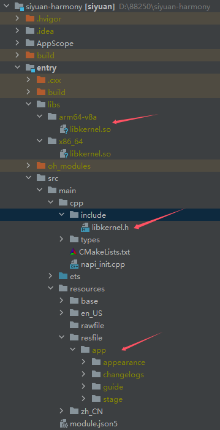
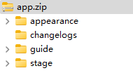

[中文](README.zh-CN.md)

## Overview

* Please go to [SiYuan issues](https://github.com/siyuan-note/siyuan/issues) to report issues/consult discussions
* Code contributions are welcome

## Construction guide

1. Refer to [SiYuan Development Guide](https://github.com/siyuan-note/siyuan/blob/master/.github/CONTRIBUTING.md) to compile the kernel
2. Build the native OCR runtime from the official ONNX Runtime v1.24.3 checkout with `python3 ../siyuan/scripts/build-ocr-harmony.py --source <onnxruntime-checkout> --ndk <sdk-native-directory> --protoc <host-protoc-3.21.12> --output entry/libs --arch arm64-v8a --work-dir <build-directory>`. The script adapts a separate source copy for Harmony Clang 15, retaining FP32/INT8 NEON inference and disabling BF16/FP16 vector paths and I8MM optimizations. The working directory retains sources, dependencies and compiled objects so the same command can resume after a failure; use a new working directory when changing the architecture, SDK or source adaptations. Use `--arch x86_64` for the emulator. CMake refuses to package a missing runtime
3. Prepare the bundled models with `python3 ../siyuan/scripts/prepare-ocr.py`; package `stage/ocr/models` and the license files in the resources alongside the frontend. Android and desktop runtime directories under `stage/ocr/runtime` are excluded from the mobile resource bundle
4. Copy the resource files and package it in entry/src/main/resources/rawfile/app.zip
   * appearance
   * guide
   * stage
   * changelogs

For unreliable networks, use `--deps-mirror <mirror-directory>` to provide the local dependency mirror supported by upstream CMake. Store archives under their original URL host and path, for example `<mirror-directory>/github.com/onnx/onnx/archive/refs/tags/v1.20.1.zip`. The pinned source's `cmake/deps.txt` defines the versions and checksums, which CMake still verifies. Dependencies absent from the mirror are downloaded from upstream.

Directory structure reference:

## Standalone Markdown host

The shared frontend resource bundle must include `stage/build/markdown/` and `appearance/langs/`. `MarkdownAbility` opens the editor without starting the workspace or Go kernel. It uses a restricted native message channel, native file grants, and private recovery records excluded from system backup. Save As chooses a directory and then a new filename so the host can reserve the target before creating it. Writable providers use checked in-place writes; the receipt means the provider accepted the content, not that cloud synchronization has finished. Persistent permission is attempted when supported; otherwise the editor reports temporary permission.

The file panel lists real folders and `.md`/`.markdown` documents lazily. A single-file grant does not authorize its parent directory: choose a folder when prompted; cancelling leaves the current document editable. Folder grants are separate from image grants. Switching reads and reserves the next document before saving or retaining the current draft, then changes the document inside the same editor container. The panel keeps its root for documents inside it, remembers width and expansion in a separate versioned private record, and refreshes through directory watchers with foreground polling for providers that do not support watching. Directory metadata calls convert authorized URIs to native paths for API 18–20 compatibility; they do not rely on URI support introduced in API 22.

`MarkdownAbility` shares the application process. Normal workspace closure defers process exit while Markdown documents remain open, but a Go panic or process termination can still stop the editor. Recovery then depends on the private records already persisted. Original-file writes are limited to 64 KiB of UTF-8, including a BOM; private drafts have an independent 16 MiB content budget. Static assets and raster images have separate 16 MiB and 32 MiB limits.

Run `node --test scripts/markdown.test.cjs scripts/exit.test.cjs` for provider fault injection and lifecycle tests. `node scripts/markdown-typecheck.cjs --arkts --ui` uses the installed Harmony SDK for checks without building the application; set `DEVECO_STUDIO_HOME` when needed and use `--warnings` to inspect SDK diagnostics. Tests use injected provider operations and do not replace device verification of ArkWeb initialization, document providers, persistent grants, lifecycle callbacks, or system backup exclusion.
