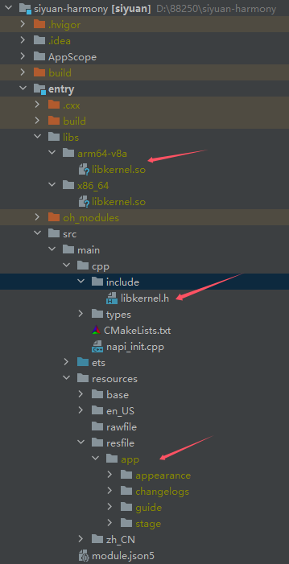
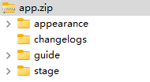

[English](README.md)

## 概述

* 报告问题/咨询讨论请到 [SiYuan issues](https://github.com/siyuan-note/siyuan/issues)
* 欢迎参与代码贡献

## 搭建步骤

1. 参考[思源笔记开发指南](https://github.com/siyuan-note/siyuan/blob/master/.github/CONTRIBUTING.zh-CN.md)编译内核
2. 使用官方 ONNX Runtime v1.24.3 检出目录构建原生 OCR 运行库：`python3 ../siyuan/scripts/build-ocr-harmony.py --source <onnxruntime-checkout> --ndk <sdk-native-directory> --protoc <host-protoc-3.21.12> --output entry/libs --arch arm64-v8a --work-dir <build-directory>`。脚本在独立副本中适配鸿蒙 Clang 15，保留 FP32/INT8 NEON 推理，关闭 BF16/FP16 向量路径和 I8MM 优化。工作目录保留源码、依赖和编译产物，失败后可使用相同命令继续；更换架构、SDK 或源码适配后需使用新的工作目录。模拟器使用 `--arch x86_64`。缺少运行库时，CMake 会明确拒绝打包
3. 执行 `python3 ../siyuan/scripts/prepare-ocr.py` 准备内置模型，将 `stage/ocr/models` 和许可证文件随前端资源打包。移动端资源包需排除 `stage/ocr/runtime` 中的 Android 和桌面运行库目录
4. 拷贝资源文件并打包 entry/src/main/resources/rawfile/app.zip
   * appearance
   * guide
   * stage
   * changelogs

网络不稳定时，可通过 `--deps-mirror <mirror-directory>` 使用上游 CMake 支持的本地依赖镜像。镜像内按原始下载 URL 的域名和路径保存压缩包，例如 `<mirror-directory>/github.com/onnx/onnx/archive/refs/tags/v1.20.1.zip`；版本和校验值以固定源码中的 `cmake/deps.txt` 为准，CMake 仍会校验文件。未缓存的依赖会从上游下载。

目录结构参考：

## 独立 Markdown 宿主

共享前端资源包需包含 `stage/build/markdown/` 和 `appearance/langs/`。`MarkdownAbility` 打开编辑器时不启动工作空间或 Go 内核，使用受限原生消息通道、原生文件授权，以及排除系统备份的私有恢复记录。另存为先选择目录，再输入尚不存在的文件名，以便宿主在创建目标前预留。可写提供方使用写前复核、写后核验的原位写入；保存回执表示提供方已接收内容，不表示云端同步完成。平台支持时尝试持久授权，否则界面提示临时授权。

文件面板按需列出真实目录和 `.md`、`.markdown` 文档。单文件授权不包含父目录权限，需要时由用户选择文件夹；取消后仍可编辑当前文稿，目录授权也不扩展图片读取权限。切换前先读取并预留下一文件，再保存当前文稿或保留草稿，最后在同一编辑容器内更换文档。根目录内切换保持当前根目录，展开状态与宽度存入独立、带版本的私有记录；目录监听与前台轮询共同处理文件变化，不支持监听的提供方使用轮询。目录元数据查询在原生侧把已授权 URI 转换为路径，兼容 API 18–20，不依赖 API 22 才支持的 URI 查询。

`MarkdownAbility` 与应用共享进程。正常关闭工作空间时，只要 Markdown 文档仍打开就延迟进程退出；Go panic 或整个进程被终止仍可能结束编辑器，此时恢复依赖已经持久化的私有记录。原文件写入上限为含 BOM 的 64 KiB UTF-8，私有草稿使用独立的 16 MiB 内容预算；静态资源和栅格图片分别使用独立的 16 MiB、32 MiB 限额。

通过 `node --test scripts/markdown.test.cjs scripts/exit.test.cjs` 运行提供方故障注入和生命周期测试。`node scripts/markdown-typecheck.cjs --arkts --ui` 使用已安装的 Harmony SDK 检查代码，不构建应用；需要时设置 `DEVECO_STUDIO_HOME`，使用 `--warnings` 查看 SDK 提示。测试使用注入的提供方操作，不能替代设备上的 ArkWeb 初始化、文档提供方、持久授权、生命周期回调和系统备份排除验证。
